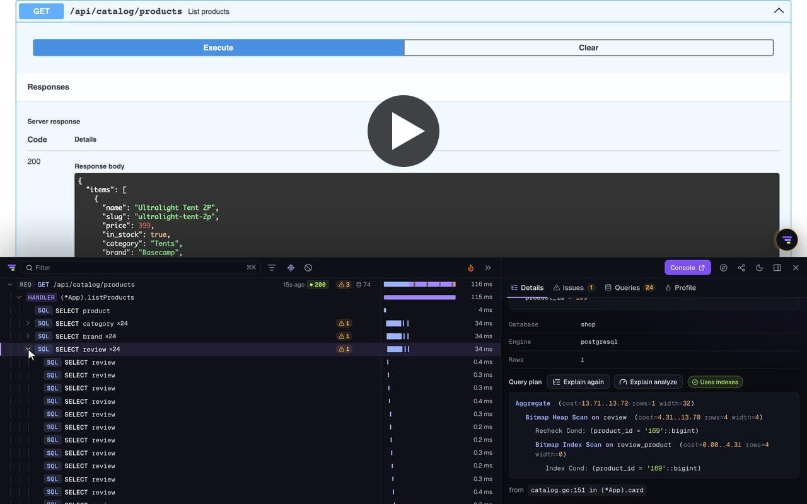

# Tracepanel for Go

[](https://github.com/tracepanel/tracepanel-go/actions/workflows/ci.yml)
[](https://pkg.go.dev/github.com/tracepanel/tracepanel-go)
[](https://pkg.go.dev/github.com/tracepanel/tracepanel-go)

**See what your Go app is really doing.** Tracepanel records each request of
your app with its SQL queries, Redis commands, outgoing HTTP and gRPC calls,
Kafka messages, logs and panics. It points out N+1 queries, duplicates, slow
SQL and long transactions, and names the line of code to fix. You read it in a
panel on your pages and in a console.

It runs while you develop, and everything stays on your machine.

[](https://tracepanel.dev/video/demo-go.mp4)

▶ [Watch the 40-second demo](https://tracepanel.dev/video/demo-go.mp4)

## Works with

| | Supported |
| --- | --- |
| **Go** | 1.26 and later, on Linux, macOS and Windows. |
| **Routers** | `net/http`'s `ServeMux`, gin, Echo v4 and v5, and any router on `net/http` (chi, gorilla) with one setting. Fiber isn't supported yet. |
| **Databases** | Any database on `database/sql` (your own queries, sqlx, sqlc, GORM, Bun), pgx and GORM. Transactions. EXPLAIN of a query on the database it came from. |
| **Redis** | go-redis v9, with its own N+1 and duplicates. |
| **Messaging** | kafka-go: what a writer sends, and each message handled as a trace of its own, linked to the one that sent it. |
| **HTTP and gRPC** | Calls made with the request's context, each with a `traceparent`. gRPC calls served and made. |
| **Background work** | Goroutines started with `tracepanel.Go` as tasks, linked to the request; commands and jobs as traces of their own. |
| **Logs** | `slog`, zap and zerolog, each record on the request that made it, with its line. |
| **Errors** | Panics, with your frames and the source around them. |
| **Profiling** | Where a request's CPU time goes, as a flame graph, when you ask for it. |
| **Browser** | The badge and its panel on your app's HTML pages and its Swagger UI. |

The core module has no dependencies. Each library integration is a module of
its own, so you get only those you use.

## Install

```bash
go get github.com/tracepanel/tracepanel-go
```

Wrap the app's handler, and give `sql.Open` the driver's name through
`tracepanel.Driver`:

```go
import tracepanel "github.com/tracepanel/tracepanel-go"

db, err := sql.Open(tracepanel.Driver("pgx"), dsn)
// ...
http.ListenAndServe(addr, tracepanel.WrapHandler(mux))
```

Run the app with `go run .`. The first request starts the agent, which keeps
the traces and serves the console: the badge on an HTML page opens it, and the
`Tracepanel-Url` header names it. The SDK downloads the agent the first time
and checks it against the checksums it was released with.

Pass the request's context down (`db.QueryContext(r.Context(), ...)`): a query,
a log record or a call joins the request's trace through it.

## Development only

Tracepanel records under `go run` only. A binary built with `go build` records
nothing: `WrapHandler`, `Driver` and the rest hand back what they were given,
and no agent is downloaded or started. `TRACEPANEL_ENABLED=1` records in any
build, and `0` never. To record a built binary:

```bash
go install github.com/tracepanel/tracepanel-go/cmd/tracepanel@v0.16.0
tracepanel run ./shop
```

## Integrations

| Library | Module |
| --- | --- |
| gin | `github.com/tracepanel/tracepanel-go/gintrace` |
| Echo v4, v5 | `github.com/tracepanel/tracepanel-go/echotrace`, `echo5trace` |
| pgx v5 | `github.com/tracepanel/tracepanel-go/pgxtrace` |
| GORM v2 | `github.com/tracepanel/tracepanel-go/gormtrace` |
| go-redis v9 | `github.com/tracepanel/tracepanel-go/redistrace` |
| zap | `github.com/tracepanel/tracepanel-go/zaptrace` |
| zerolog | `github.com/tracepanel/tracepanel-go/zerologtrace` |
| gRPC | `github.com/tracepanel/tracepanel-go/grpctrace` |
| kafka-go | `github.com/tracepanel/tracepanel-go/kafkatrace` |

Each takes a line:

```go
router.Use(gintrace.Middleware())                 // gin
err = db.Use(gormtrace.Plugin())                  // GORM
config.ConnConfig.Tracer = pgxtrace.Tracer()      // pgx
redistrace.Instrument(rdb)                        // go-redis
server := grpc.NewServer(grpctrace.ServerOptions()...)
```

The [integrations](https://tracepanel.dev/docs/go/integrations) page has each
one, and what it records.

## Your own code

```go
// A span of the request's trace.
ctx, end := tracepanel.Span(ctx, "render invoice")
defer end()

// A task: a trace of its own, linked to the request that started it.
tracepanel.Go(ctx, "send welcome email", func(ctx context.Context) error {
	return mailer.Send(ctx, user)
})

// The signed-in user.
tracepanel.SetUser(ctx, strconv.FormatInt(user.ID, 10), user.Email)

// A debug print: each value with its expression, on stderr and in the trace.
tracepanel.Dump(ctx, order, user.Roles)
```

A program without an HTTP server calls `tracepanel.Setup()` first and
`tracepanel.Flush(time.Second)` before it exits.

## MCP

The same traces for an AI coding agent (Claude Code, Cursor, Codex), from the
project's directory:

```bash
claude mcp add --scope project tracepanel -- tracepanel mcp
```

## Documentation

The documentation is at
[tracepanel.dev/docs/go](https://tracepanel.dev/docs/go): installing, the
integrations, tracing your code, the settings and the `tracepanel` command.
The panel, the console and the issues are the same in every language, under
[tracepanel.dev/docs](https://tracepanel.dev/docs).

## Links

- [tracepanel](https://github.com/tracepanel/tracepanel): what Tracepanel finds,
  how it works, privacy, and the agent this SDK downloads
- [CHANGELOG.md](CHANGELOG.md): what changed in each version

## Development

```bash
make lint       # gofmt, go vet, the tests of every module, every module built for Windows
make e2e        # an app against the real agent (e2e/, a module of its own)
make integrity  # the checksums of AgentVersion's binaries, once it is on npm
```

The tests that run the agent take a build of the sibling `tracepanel`
checkout, or the one `TRACEPANEL_AGENT_BIN` names. Each integration is a
module of its own, with a `replace` of the core to the checkout.

## License

Licensed under the [MIT License](LICENSE). The agent the SDK downloads,
`tracepanel-agent`, is free to use under the
[FSL-1.1-ALv2](https://github.com/tracepanel/tracepanel/blob/main/LICENSE):
source available, and Apache-2.0 two years after each release.
